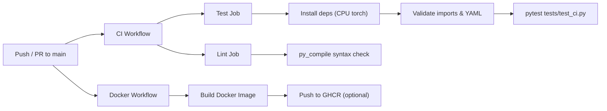

# VisionQC — GitHub Actions CI/CD

This document explains the Continuous Integration / Continuous Delivery (CI/CD) pipelines configured for VisionQC using **GitHub Actions**.

---

## Overview

| Workflow | File | Triggers | Purpose |
|----------|------|----------|---------|
| **CI — Tests & Lint** | `.github/workflows/ci.yml` | Push to `main`, PRs → `main` | Validate code quality, run tests, check syntax |
| **Docker Build** | `.github/workflows/docker.yml` | Push to `main`, manual dispatch | Build the Docker container image, optionally push to GHCR |



---

## 1. CI Workflow (`ci.yml`)

### Triggers

- **`push`** to `main` — runs automatically when code is merged.
- **`pull_request`** targeting `main` — validates PRs before merge.

### Job 1: `test`

Runs on `ubuntu-latest` with Python 3.12.

| Step | What it does |
|------|--------------|
| **Checkout** | Clones the repository using `actions/checkout@v4`. |
| **Setup Python** | Installs Python 3.12 via `actions/setup-python@v5`. |
| **Install CPU PyTorch** | Installs `torch` and `torchvision` from the CPU-only PyTorch index to avoid downloading large GPU wheels. |
| **Install dependencies** | Runs `pip install -r requirements.txt` plus `prometheus-client`. |
| **Validate imports** | Checks that the FastAPI app, Detection class, and settings module all import without errors. |
| **Validate YAML configs** | Parses every `configs/training*.yaml` file with `pyyaml` to catch syntax problems early. |
| **Run tests** | Executes `pytest tests/test_ci.py -v --tb=short` — the CI-safe test suite that uses mocking instead of real model weights. |

### Job 2: `lint`

A lightweight syntax-check job running on `ubuntu-latest`.

| Step | What it does |
|------|--------------|
| **Checkout** | Clones the repository. |
| **Setup Python** | Installs Python 3.12. |
| **py_compile** | Runs `python -m py_compile` against every key source file to catch syntax errors instantly. |

> [!NOTE]
> The `test` and `lint` jobs run **in parallel** — they have no dependency on each other.

---

## 2. Docker Workflow (`docker.yml`)

### Triggers

- **`push`** to `main` — builds automatically on every merge.
- **`workflow_dispatch`** — allows manual builds from the GitHub Actions UI.

### Job: `build`

| Step | What it does |
|------|--------------|
| **Checkout** | Clones the repository. |
| **Setup Buildx** | Configures Docker Buildx for improved layer caching via `docker/setup-buildx-action@v3`. |
| **Build image** | Builds the image using the project `Dockerfile`, tagging it as `ghcr.io/anmol-tech17/visionqc:<sha>` and `:latest`. |
| **Inspect image** | Prints the image details to the log. |
| **Login to GHCR** | Authenticates to GitHub Container Registry using `GITHUB_TOKEN` (runs only on `main` pushes, soft-fails if permissions aren't configured). |
| **Push to GHCR** | Pushes both tags to GHCR (soft-fails with a warning if credentials aren't set up). |

> [!TIP]
> To enable GHCR publishing, ensure the repository's **Settings → Actions → General → Workflow permissions** is set to **"Read and write permissions"**.

---

## 3. CI-Safe Tests (`tests/test_ci.py`)

The existing `tests/test_api.py` loads the real YOLO model via MLflow, which requires model weights and an MLflow database — neither of which is available in CI. A dedicated `tests/test_ci.py` file provides tests that work in any environment:

| Test | What it validates |
|------|-------------------|
| `test_imports` | Core modules (`Detection`, `draw_detections`, `settings`) import without error. |
| `test_detection_dataclass` | `Detection` dataclass creation and `.to_dict()` serialization work correctly. |
| `test_api_health_no_model` | The `/health` endpoint returns valid JSON when the model is `None` (returns 503 with `"degraded"` status). |
| `test_api_predict_no_model` | The `/predict` endpoint returns 503 when the model is unavailable. |
| `test_settings_config` | `configs/settings.py` exposes the expected constants (`APP_TITLE`, thresholds, class names, colours). |

> [!IMPORTANT]
> Only `tests/test_ci.py` runs in the CI pipeline. The full integration test (`tests/test_api.py`) should be run locally where model weights and MLflow are available.

---

## 4. How to View Results on GitHub

1. Go to the repository: [https://github.com/Anmol-tech17/VisionQC](https://github.com/Anmol-tech17/VisionQC).
2. Click the **"Actions"** tab at the top.
3. Select a workflow run to see individual job logs.
4. Each job shows ✅ (pass) or ❌ (fail) with expandable step logs.

On pull requests, the CI status appears as a check next to the PR title:

- ✅ **All checks passed** — safe to merge.
- ❌ **Some checks failed** — click "Details" to diagnose.

---

## 5. How to Rerun Failed Workflows

1. Navigate to **Actions → the failed run**.
2. Click **"Re-run all jobs"** (top-right) or **"Re-run failed jobs"** to retry only the broken step.
3. You can also trigger the Docker workflow manually via **"Run workflow"** on the workflow page.

---

## 6. Limitations

| Limitation | Explanation |
|------------|-------------|
| **No GPU** | All CI jobs use CPU-only PyTorch. Training and full inference are not performed in CI. |
| **No model weights in CI** | The YOLO `.pt` weights and MLflow database are not committed to Git. CI tests use mocked models. |
| **No cloud deployment** | The workflows build and test locally; they do not deploy to AWS, GCP, Azure, or any cloud service. |
| **GHCR push is optional** | The Docker workflow soft-fails on push if GHCR permissions aren't enabled. |
| **DVC data not pulled** | The CI pipeline does not run `dvc pull` — dataset files tracked by DVC are not available in CI. |
| **Airflow not tested** | The Airflow DAG (`dags/visionqc_pipeline.py`) is not executed in CI. |

---

## File Structure

```
VisionQC/
├── .github/
│   └── workflows/
│       ├── ci.yml            ← CI tests & lint
│       └── docker.yml        ← Docker build & optional GHCR push
├── tests/
│   ├── test_ci.py            ← CI-safe tests (mocked, no model weights)
│   ├── test_api.py           ← Full integration tests (local only)
│   └── __init__.py
├── Dockerfile
└── requirements.txt
```
