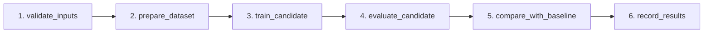

# VisionQC — Complete Technical Project Overview & Developer Onboarding Manual

**Project Name:** VisionQC: Automated Manufacturing Defect Inspection  
**Repository:** `https://github.com/Anmol-tech17/VisionQC`  
**Target Audience:** Machine learning engineers, software developers, and MLOps practitioners onboarding to VisionQC.  
**Authoritative Documentation:** `docs/PROJECT_OVERVIEW.md`  

---

## 1. Project Introduction

### 1.1 Problem Statement
In high-volume electronics manufacturing, Printed Circuit Board (PCB) quality assurance is critical. Fabricating multilayer PCBs involves photolithography, etching, plating, and solder masking. Defects such as broken traces (`open_circuit`), unwanted bridges (`short`), missing pads (`missing_pad`), or microscopic conductor notches (`mouse_bite`) cause catastrophic electrical failures if not detected early. Manual optical inspection by human technicians is slow, fatiguing, subjective, and costly. 

### 1.2 Project Objectives
VisionQC provides an automated, production-grade computer vision and MLOps system that:
1. Accurately detects and localizes microscopic PCB surface defects in high-resolution images.
2. Manages data lineage, versioning, and large image datasets reproducibly using DVC.
3. Systematically tracks machine learning experiments, hyperparameters, and models using MLflow.
4. Packages the champion defect detection model into a high-performance REST API with FastAPI and Docker.
5. Provides a dark-themed, industrial web console for manufacturing operators.
6. Automates recurring training, validation, evaluation, and baseline comparison pipelines via Apache Airflow.
7. Guarantees code quality, syntax validity, and container buildability via GitHub Actions CI/CD.
8. Exposes real-time system throughput, latency percentiles, and inference telemetry via Prometheus and Grafana.

### 1.3 Scope & Target Use Case
VisionQC is designed for edge deployment inside an electronics manufacturing facility (e.g., surface mount technology line). High-resolution cameras capture images of boards as they exit the etching or soldering stations and post them to the VisionQC inspection service. Inference runs locally on standard CPU hardware or specialized edge accelerators, instantly returning bounding boxes, defect classifications, and quality pass/fail decisions.

---

## 2. System Architecture

```mermaid
flowchart TD
    subgraph Data & Versioning
        RawData[Raw PCB Dataset: Rashid 2025] -->|DVC Tracking| DVCStorage[(DVC Remote Cache on D:)]
        RawData -->|prepare_dataset.py| PreparedData[YOLO Formatted Dataset: 640x640]
    end

    subgraph Experiment Tracking & Registry
        PreparedData -->|train.py| YOLOModels[YOLOv8 Models]
        YOLOModels -->|evaluate.py| Metrics[mAP50, Precision, Recall, Latency]
        Metrics -->|Log Metrics & Artifacts| MLflow[(MLflow SQLite: mlflow.db)]
        MLflow -->|Tag Champion Model| Champion[VisionQC-Detector@champion v2]
    end

    subgraph Orchestration Stack
        AirflowDAG[visionqc_pipeline.py] -->|1. Validate| Task1[validate_inputs]
        Task1 -->|2. Prepare| Task2[prepare_dataset]
        Task2 -->|3. Train| Task3[train_candidate]
        Task3 -->|4. Evaluate| Task4[evaluate_candidate]
        Task4 -->|5. Compare| Task5[compare_with_baseline]
        Task5 -->|6. Record| Task6[record_results]
    end

    subgraph Containerized Inference & GUI
        Champion -->|Dynamic Fetch on Lifespan| FastAPIService[FastAPI Server: Port 8000]
        FastAPIService -->|Serves Root GET /| WebGUI[Industrial Web Dashboard]
        FastAPIService -->|Exposes GET /metrics| MetricsEndpoint[/metrics]
        FastAPIService -->|Processes POST /predict| LiveInference[Ultralytics YOLO Engine]
    end

    subgraph Telemetry & Monitoring Stack
        MetricsEndpoint -->|Scraped every 10s| Prometheus[Prometheus: Port 9090]
        Prometheus -->|Auto-provisioned Datasource| Grafana[Grafana Dashboard: Port 3000]
    end

    subgraph Continuous Integration
        GitPush[Git Commit & Push] -->|Trigger| GitHubActions[GitHub Actions Runners]
        GitHubActions -->|ci.yml| TestJob[Imports, Configs & pytest]
        GitHubActions -->|docker.yml| BuildJob[Docker Buildx Build]
    end
```

### 2.1 Component Responsibilities
* **Data Layer:** Organizes raw COCO datasets, converts coordinates to normalized YOLO format (`[class, x_center, y_center, width, height]`), and isolates binary images using DVC.
* **Training & Experiment Layer:** Executes YOLOv8 transfer learning, tunes hyperparameters (epochs, image size, batch size, augmentations), and registers models in MLflow.
* **Orchestration Layer:** Airflow schedules and executes pipeline steps, comparing new candidates against established baseline benchmarks.
* **Serving Layer:** FastAPI provides low-latency REST endpoints with Swagger documentation, input validation, and automatic fallback model loading.
* **Presentation Layer:** Vanilla HTML5/CSS3/JavaScript interface engineered with an industrial dark theme, drag-and-drop file upload, and real-time bounding box visualization.
* **Monitoring Layer:** Prometheus scrapes time-series metrics from FastAPI; Grafana renders 9 telemetry panels showing request volume, latency percentiles, and inference health.

---

## 3. Technology Stack

| Technology | Version | Role in VisionQC |
|---|---|---|
| **Python** | 3.12 (Docker) / 3.13 (Local) | Core programming language for all pipelines, scripts, and services. |
| **Ultralytics YOLOv8** | 8.4.160 | State-of-the-art single-stage object detection architecture fine-tuned for PCB defect localization. |
| **PyTorch** | 2.4.1+cpu / 2.14.0 | Deep learning backend powering tensor operations and neural network inference. |
| **OpenCV (cv2)** | 4.10+ | Decodes image buffers, resizes input arrays, and renders high-visibility bounding boxes server-side. |
| **Pillow (PIL)** | 11.3.0 | Image file I/O, format inspection, and color-space conversions (RGB/BGR). |
| **FastAPI** | 0.135.0 | High-performance asynchronous web framework serving the REST API and static UI. |
| **Uvicorn** | >=0.41.0 | Asynchronous Server Gateway Interface (ASGI) web server. |
| **DVC (Data Version Control)** | >=3.0.0 | Tracks large binary image directories without bloating Git history. |
| **MLflow** | >=2.0.0 / 3.18.0 | Manages experiments, parameter logging, metric comparisons, and the Model Registry. |
| **Apache Airflow** | 2.10.3 | Workflow orchestrator executing DAG-based training and candidate evaluation pipelines. |
| **Docker & Docker Compose** | 29.9.2 / Compose v2.x | Containerizes services into isolated, reproducible runtime environments. |
| **GitHub Actions** | v4/v5 Actions | Cloud CI/CD automation running test suites, schema checks, and container image builds. |
| **Prometheus** | v2.51.0 | Time-series database scraping API metrics every 10 seconds. |
| **Grafana** | 10.4.0 | Multi-panel observability dashboard visualizing throughput, error rates, and inference latency. |

---

## 4. Repository Structure

```
VisionQC/
├── .github/
│   └── workflows/
│       ├── ci.yml                     # GitHub Actions CI: imports, configs, mock tests, lint
│       └── docker.yml                 # GitHub Actions CD: Docker Buildx container build
├── .dvc/
│   ├── .gitignore
│   └── config                         # DVC local storage remote configuration
├── artifacts/
│   └── models/                        # Trained model weight checkpoints
│       ├── pcb_yolov8n/               # Champion model directory (YOLOv8s, 21.5 MB best.pt)
│       ├── pcb_yolov8n_640/           # Experiment A (YOLOv8n @ 640px, 5.9 MB best.pt)
│       └── pcb_yolov8n_baseline/      # Phase 2 Baseline (YOLOv8n @ 320px, 5.9 MB best.pt)
├── configs/
│   ├── settings.py                    # Central application settings and environment variables
│   ├── training.yaml                  # Default training hyperparameters
│   ├── training_exp_1.yaml            # Airflow candidate training configuration
│   ├── training_exp_2.yaml            # Hyperparameter experiment 2
│   ├── training_exp_3.yaml            # Hyperparameter experiment 3
│   ├── training_exp_a.yaml            # Experiment A (640px resolution)
│   └── training_exp_b.yaml            # Experiment B (combined datasets)
├── dags/
│   └── visionqc_pipeline.py           # Apache Airflow 6-task training pipeline DAG
├── data/
│   ├── prepared/                      # YOLO-formatted dataset (train/val/test splits)
│   │   ├── dataset.yaml               # YOLO dataset descriptor with class names
│   │   ├── train/ (images, labels)    # Training split (161 images)
│   │   ├── val/ (images, labels)      # Validation split (34 images)
│   │   └── test/ (images, labels)     # Held-out test split (35 images)
│   └── raw/
│       ├── rashid/                    # Rashid (2025) raw COCO dataset
│       │   ├── annotation/            # _annotations.coco.json
│       │   └── images/                # Raw PCB JPEG images
│       ├── rashid.dvc                 # DVC pointer tracking raw Rashid dataset
│       └── mendeley.dvc               # DVC pointer tracking raw Mendeley dataset
├── docs/
│   ├── DATASET_RESEARCH.md            # Academic research on available PCB datasets
│   ├── DATA_CARD.md                   # Formal dataset card (provenance, classes, distributions)
│   ├── DEMO_GUIDE.md                  # Concise live demonstration manual
│   ├── FINAL_IMPLEMENTATION_REPORT.md # 15-section comprehensive final milestone report
│   ├── GITHUB_ACTIONS_CICD.md         # CI/CD architecture, workflow steps, and execution guide
│   ├── MODEL_CARD.md                  # Formal model card (metrics, architectures, champion selection)
│   ├── MONITORING_GUIDE.md            # Prometheus & Grafana setup, metrics, and PromQL queries
│   ├── PHASE_IMPLEMENTATION_REPORT.md # Authoritative phasewise history (Phases 1–6)
│   └── PROJECT_OVERVIEW.md            # THIS FILE: Comprehensive onboarding and developer manual
├── monitoring/
│   ├── grafana/
│   │   └── provisioning/
│   │       ├── dashboards/
│   │       │   ├── dashboards.yml     # Auto-import provider configuration
│   │       │   └── visionqc-api.json  # 9-panel VisionQC API Monitoring dashboard
│   │       └── datasources/
│   │           └── prometheus.yml     # Auto-configured Prometheus datasource
│   └── prometheus/
│       └── prometheus.yml             # Scrape configuration targeting visionqc-api:8000
├── reports/                           # Evaluation JSONs, CSVs, and markdown summaries
├── scripts/
│   ├── audit_dataset.py               # Inspects dataset distributions and box sizes
│   ├── evaluate.py                    # Evaluates a model checkpoint on test split & logs to MLflow
│   ├── finalize_experiment.py         # Registers and tags candidate models in MLflow
│   ├── prepare_dataset.py             # Converts COCO annotations to YOLO format splits
│   └── train.py                       # Ultralytics YOLO training harness
├── src/
│   └── visionqc/
│       ├── api/
│       │   ├── static/
│       │   │   └── index.html         # Industrial dark-theme web dashboard
│       │   └── main.py                # FastAPI server, Prometheus middleware, endpoints
│       ├── data/
│       │   ├── dataset_prep.py        # Coordinate conversion logic
│       │   └── validator.py           # Dataset integrity checks
│       └── inference/
│           ├── model_loader.py        # Thread-safe Singleton model loader
│           ├── predictor.py           # YOLOPredictor and GTAnnotationLookup classes
│           └── visualizer.py          # OpenCV bounding box and label rendering
├── tests/
│   ├── test_api.py                    # End-to-end API test with live YOLO model
│   └── test_ci.py                     # Mock-isolated CI unit tests (no weights required)
├── .dockerignore                      # Docker build exclusion rules
├── .gitignore                         # Git tracking exclusion rules
├── docker-compose.airflow.yml         # Apache Airflow Compose configuration
├── docker-compose.monitoring.yml      # Prometheus & Grafana Compose configuration
├── docker-compose.yml                 # FastAPI Inference Service Compose configuration
├── Dockerfile                         # Multi-stage production container specification
├── main.py                            # Standalone Python entrypoint launcher
├── mlflow.db                          # Local SQLite MLflow experiment tracking database
├── requirements.txt                   # Pinned project dependencies
└── README.md                          # Project landing documentation
```

---

## 5. Dataset Documentation

### 5.1 Dataset Provenance
VisionQC evaluated two distinct datasets:
1. **PCB-Defect (Rashid 2025):** 230 real-world, high-resolution photographs of physical PCBs captured under diverse lighting and manufacturing conditions.
2. **Mixed PCB Defect Dataset (Mendeley):** 1,386 synthetic images generated by programmatically pasting graphic artifacts onto pristine PCB backgrounds.

**Final Decision:** The champion model was trained **exclusively on the Rashid (2025) dataset**. As documented in Phase 3, mixing synthetic Mendeley data introduced an artificial domain shift that degraded real-world precision.

### 5.2 Defect Classes
VisionQC detects 6 primary PCB surface defects:

| Class ID | Defect Name | Visual Description | Manufacturing Cause |
|---|---|---|---|
| `0` | `missing_pad` | Missing rectangular/circular copper soldering pad. | Etching overexposure or mechanical abrasion. |
| `1` | `mouse_bite` | Small, rounded notch missing from conductor edge. | Uneven breakaway tab de-paneling or over-etching. |
| `2` | `open_circuit` | Complete discontinuity or gap in a conductive trace. | Dust during photolithography or scratch in copper. |
| `3` | `short` | Unintended conductive bridge connecting two traces. | Solder bridging or incomplete chemical etching. |
| `4` | `spur` | Sharp, triangular copper projection from a trace edge. | Mask leakage or contamination on the negative film. |
| `5` | `spurious_copper` | Isolated copper island in an unrouted board zone. | Incomplete etching bath agitation. |

### 5.3 Splits & Small-Object Distribution
* **Total Images:** 230 images
* **Split Ratios:** 70% Train (161 images), 15% Validation (34 images), 15% Test (35 images)
* **Random Seed:** 42 (fixed for strict reproducibility)
* **Crucial Finding:** Dataset auditing revealed that **96.3% of defect bounding boxes occupy less than 5% of the total image area**. Tiny defects vanish when downsampled to 320×320 pixels, dictating that a minimum resolution of **640×640 pixels** is required for industrial accuracy.

---

## 6. Model Documentation

### 6.1 Baseline vs. Champion Model Comparison

| Attribute | Phase 2 Baseline | Phase 4A Experiment A | Phase 4A Champion Model |
|---|---|---|---|
| **Architecture** | YOLOv8n (Nano) | YOLOv8n (Nano) | **YOLOv8s (Small)** |
| **Backbone** | CSPDarknet (3.2M params) | CSPDarknet (3.2M params) | **CSPDarknet (11.2M params)** |
| **Input Resolution**| 320 × 320 px | 640 × 640 px | **640 × 640 px** |
| **Epochs Trained** | 20 | 40 | **40** |
| **Batch Size** | 16 | 8 | **8** |
| **Weights Size** | 5.92 MB | 5.94 MB | **21.46 MB** |
| **mAP50** | **0.1650** | 0.7527 | **0.8137** |
| **mAP50-95** | 0.0520 | 0.3812 | **0.4294** |
| **Precision** | 0.2470 | 0.8192 | **0.8284** |
| **Recall** | 0.1668 | 0.6954 | **0.7863** |
| **CPU Latency** | ~95 ms | ~140 ms | **~346 ms** |
| **Registry Alias** | *None* | `candidate` | **`champion` (Version 2)** |
| **Check Location** | `artifacts/models/pcb_yolov8n_baseline/` | `artifacts/models/pcb_yolov8n_640/` | `artifacts/models/pcb_yolov8n/` |

### 6.2 Key Metric Definitions
* **mAP50 (Mean Average Precision @ IoU 0.5):** The area under the Precision-Recall curve evaluated at an Intersection-over-Union threshold of 0.5. A box is considered a correct detection if it overlaps the ground truth by at least 50%.
* **mAP50-95:** The average mAP computed across IoU thresholds from 0.50 to 0.95 in steps of 0.05, representing bounding box tightness and localization precision.
* **Precision:** $\frac{TP}{TP + FP}$ — proportion of detected defect boxes that were genuine defects.
* **Recall:** $\frac{TP}{TP + FN}$ — proportion of actual manufacturing defects that the model successfully caught.

---

## 7. DVC (Data Version Control)

### 7.1 Architecture & Role
Raw datasets are excluded from Git using `.gitignore` because large binaries bloat git packfiles and cause clone timeouts. DVC decouples file metadata from data content:
* Small pointer files (`data/raw/rashid.dvc`, `mendeley.dvc`) containing MD5 checksums are tracked in Git.
* The actual raw image payloads are cached in an external directory configured in `.dvc/config`:
  ```ini
  [core]
      remote = local_storage
  ['remote "local_storage"']
      url = ../../dvc_storage
  ```

### 7.2 Developer DVC Commands
```bash
# Check DVC tracked data status
dvc status

# Pull data from local remote (if storage exists)
dvc pull data/raw/rashid.dvc

# Re-run dataset preparation
python scripts/prepare_dataset.py
```

---

## 8. MLflow Experiment Tracking & Registry

### 8.1 SQLite Backend
MLflow is configured with a local SQLite backend tracking URI:
```
sqlite:///mlflow.db
```
Artifacts are stored under `mlruns/`. This keeps tracking metadata fully relational, local, and operable without requiring cloud accounts.

### 8.2 Inspecting MLflow
To launch the interactive MLflow user interface:
```powershell
& "C:\Program Files\Python313\python.exe" -m mlflow ui --backend-store-uri sqlite:///mlflow.db
```
Open `http://localhost:5000`:
* Navigate to **Experiments** to view runs from `VisionQC_Training` and `VisionQC_Evaluation`.
* Navigate to **Models** → **VisionQC-Detector**:
  * Version 1: Initial YOLOv8n baseline.
  * Version 2: YOLOv8s 640px model tagged with alias **`champion`**.

---

## 9. FastAPI and Inference Service

### 9.1 Service Entrypoint
The FastAPI application is defined in `src/visionqc/api/main.py`. It can be run standalone via `main.py` or inside Docker.

### 9.2 API Endpoints
* `GET /`: Serves the industrial inspection web interface.
* `GET /health`: Health check endpoint. Returns `status` (`ok` or `degraded`), `model_loaded` (bool), `model_version`, `model_name`, and `class_names`.
* `POST /predict`: Accepts a multipart image upload (`file`). Executes YOLO inference and returns:
  ```json
  {
    "predictions": [...],
    "detections": [
      {
        "class_name": "mouse_bite",
        "class_id": 1,
        "confidence": 0.8842,
        "bbox": [142.5, 310.2, 45.0, 38.5]
      }
    ],
    "count": 1,
    "annotated_image": "<base64_encoded_jpeg>",
    "prediction_type": "yolo_model",
    "inference_time_ms": 284.5,
    "model_name": "VisionQC-Detector v2"
  }
  ```
* `GET /metrics`: Prometheus text-format scrape endpoint.
* `GET /docs`: Interactive Swagger/OpenAPI documentation.

### 9.3 Dynamic Loading & Fallback
On application startup, the lifespan handler attempts to download weights from MLflow: `models:/VisionQC-Detector@champion`. If MLflow is unavailable, it automatically falls back to loading local weights from `configs/settings.py` (`artifacts/models/pcb_yolov8n_640/weights/best.pt`), ensuring uninterrupted operation.

---

## 10. Industrial Web GUI

### 10.1 Technology
Built using pure HTML5, vanilla CSS, and modern asynchronous JavaScript in `src/visionqc/api/static/index.html`. No bulky frontend frameworks (React/Vue/Node.js) are used, eliminating node_modules bloat and keeping the container lightweight.

### 10.2 Views
1. **Overview Dashboard:** High-contrast stat cards showing real-time service health, model version, and quick-action links.
2. **PCB Inspection Console:** Drag-and-drop file upload with live preview, loading animations, dual latency readout (server vs round-trip), rendered bounding box overlays, and detection tables.
3. **Model Information:** Technical breakdown of YOLOv8n/s architecture, input resolution, backbone, and color-coded defect class tags.
4. **System Status:** Service status indicators and quick-navigation links to `/docs`, `/health`, Prometheus (`:9090`), Grafana (`:3000`), and Airflow (`:8080`).

---

## 11. Airflow Training Pipeline

### 11.1 DAG Specification
The training workflow is orchestrated via `dags/visionqc_pipeline.py`:
* **DAG ID:** `visionqc_training_pipeline`
* **Schedule:** `@weekly` (catchup=False, max_active_runs=1)
* **Executor:** `SequentialExecutor` with SQLite backend on D: drive (`/mnt/d/visionqc-airflow/data/airflow.db`)

### 11.2 Task Flow


1. **`validate_inputs`:** Verifies project directory, training configuration YAML, and baseline metrics JSON.
2. **`prepare_dataset`:** Confirms YOLO dataset exists; regenerates it via `scripts/prepare_dataset.py` if missing.
3. **`train_candidate`:** Trains candidate model. Runs in **smoke-test mode** by default (`--epochs 1 --batch-size 2`) to avoid CPU saturation.
4. **`evaluate_candidate`:** Evaluates candidate weights on test split and pushes metrics to XCom.
5. **`compare_with_baseline`:** Compares candidate mAP50 against baseline mAP50 (0.1650).
6. **`record_results`:** Writes pipeline execution summary to `reports/airflow_pipeline_summary.json`.

*Champion Safeguard: The Airflow pipeline never automatically promotes a candidate to Champion in the registry; champion promotion requires explicit validation.*

---

## 12. Docker & Compose Architecture

### 12.1 Compose Files
1. **`docker-compose.yml` (Inference Service):**
   * Container: `visionqc-api` (`visionqc-api:latest`)
   * Ports: `8000:8000`
   * Network: `visionqc-net`
   * Limits: 1.5 CPU cores, 3.0 GB RAM
   * User: Non-root `appuser` (UID 1000)
2. **`docker-compose.monitoring.yml` (Monitoring Stack):**
   * Containers: `visionqc-prometheus` (`prom/prometheus:v2.51.0`), `visionqc-grafana` (`grafana/grafana:10.4.0`)
   * Ports: `9090:9090` (Prometheus), `3000:3000` (Grafana)
   * Network: `visionqc-net`
   * Limits: 0.5 CPU cores, 512 MB RAM each
3. **`docker-compose.airflow.yml` (Orchestration Stack):**
   * Container: `visionqc-airflow` (`apache/airflow:2.10.3-python3.12`)
   * Ports: `8080:8080`
   * Storage: Bind-mounts persistent SQLite database to `/mnt/d/visionqc-airflow/data`

*Note: In accordance with project rules, Docker Engine runs directly inside the `Ubuntu-D` WSL2 virtual machine on the D: drive. Docker Desktop is not required.*

---

## 13. GitHub Actions CI/CD

### 13.1 Workflows
* **`.github/workflows/ci.yml`:**
  * Runs on every push to `main` and all pull requests.
  * Sets up Python 3.12 with CPU-only PyTorch.
  * Validates Python imports (`app`, `Detection`, `settings`).
  * Validates syntax for all 6 training configuration YAML files.
  * Executes mock-isolated unit tests (`pytest tests/test_ci.py`).
  * Runs syntax linter (`py_compile`).
* **`.github/workflows/docker.yml`:**
  * Runs on pushes to `main` and manual dispatch.
  * Sets up Docker Buildx and builds the production Docker image.
  * Tags with commit SHA and `latest`.
  * Includes safe, non-blocking GHCR login and push (`continue-on-error: true`).

---

## 14. Prometheus and Grafana Telemetry

### 14.1 Metrics Exposed
* `http_requests_total` [Counter]: Total requests labeled by method, endpoint, and status code.
* `http_request_duration_seconds` [Histogram]: Request latency across 10 buckets (10ms to 10s).
* `http_requests_in_progress` [Gauge]: Currently processing requests.
* `visionqc_predictions_total` [Counter]: Prediction count labeled by status (`success`, `error`, `no_model`).
* `visionqc_inference_duration_seconds` [Histogram]: Pure model inference execution duration.

### 14.2 Grafana Dashboard Panels
Auto-provisioned under **VisionQC API Monitoring**:
1. Total API Requests (Stat)
2. Request Rate per second (Stat)
3. Average Latency (Stat)
4. Total Predictions (Stat)
5. Request Rate Over Time by Endpoint (Timeseries)
6. Response Latency Quantiles: p50, p95, p99 (Timeseries)
7. HTTP Status Codes Distribution (Stacked Bar Chart)
8. YOLO Model Inference Duration: p50, p95 (Timeseries)
9. Predictions by Status (Timeseries)

---

## 15. Installation & Setup Guide

### 15.1 Prerequisites
* Windows 10/11 with WSL2 enabled.
* WSL2 distribution: `Ubuntu-D` (with Docker Engine installed inside).
* Python 3.12 or 3.13 installed on Windows.
* Git.

### 15.2 Step-by-Step Local Setup

1. **Clone Repository:**
   ```bash
   git clone https://github.com/Anmol-tech17/VisionQC.git
   cd VisionQC
   ```

2. **Set Up Python Environment:**
   ```powershell
   # Install dependencies (CPU-only PyTorch first)
   pip install torch torchvision --index-url https://download.pytorch.org/whl/cpu
   pip install -r requirements.txt
   ```

3. **Verify Installation:**
   ```powershell
   pytest tests/test_ci.py -v
   ```

4. **Launch Inference Service:**
   ```powershell
   python main.py
   ```
   Open `http://localhost:8000` in your web browser.

---

## 16. Common Developer Workflows

### Running Automated Tests
```powershell
# Run CI mock tests (~3s)
pytest tests/test_ci.py -v

# Run full API integration test with model inference (~15s)
python tests/test_api.py
```

### Performing Headless Prediction via cURL
```bash
curl -X POST http://localhost:8000/predict \
  -F "file=@data/prepared/test/images/pcb_defect_007.jpg"
```

### Running Docker Stacks (inside Ubuntu-D WSL)
```bash
# 1. Start API
docker compose up -d

# 2. Start Monitoring
docker compose -f docker-compose.monitoring.yml up -d

# 3. Stop All
docker compose -f docker-compose.monitoring.yml down
docker compose down
```

---

## 17. Troubleshooting

* **Model Loading Degraded:** If `mlflow.db` is locked or unavailable, verify that `artifacts/models/pcb_yolov8n_640/weights/best.pt` exists. The service will automatically fall back to local weights.
* **WSL2 Docker Daemon Inactive:** If Docker fails to respond, run `wsl.exe -d Ubuntu-D -u root -e service docker restart`.
* **Port Conflicts:** Ensure ports 8000 (API), 9090 (Prometheus), 3000 (Grafana), and 8080 (Airflow) are free before launching compose stacks.

---

## 18. Current Project Status

| Area | Implementation Status | Verification Evidence |
|---|---|---|
| **YOLO Defect Detection** | Complete | Evaluated on held-out test split (mAP50=0.8137) |
| **Data Versioning (DVC)** | Complete | Pointers tracked, remote storage configured |
| **Experiment Tracking (MLflow)**| Complete | 16 runs logged in `mlflow.db`, Champion registered |
| **Inference REST API** | Complete | `/health`, `/predict`, `/metrics`, `/docs` tested |
| **Industrial Web GUI** | Complete | 4 interactive views, live upload & annotation verified |
| **Airflow Pipeline** | Complete | 6-task DAG syntax and import verified |
| **Containerization** | Complete | Dockerfile & 3 Compose configurations verified |
| **CI/CD Automation** | Complete | GitHub Actions CI & Docker workflows active |
| **Prometheus & Grafana** | Complete | Metric scrape verified, 9-panel dashboard tested |

---

## 19. Future Improvements (Post-Course Scope)
* **GPU / TensorRT Acceleration:** Export trained PyTorch weights to ONNX/TensorRT for sub-10ms inference on NVIDIA Jetson edge devices.
* **Automated Data Drift Detection:** Integrate Evidently AI or Whylogs to detect camera defocus, sensor degradation, and lighting distribution drift.
* **Kubernetes Orchestration:** Package the Compose services into Helm charts for deployment on multi-node industrial clusters.

---

## 20. Glossary

* **Bounding Box (BBox):** Rectangle coordinates $[x, y, w, h]$ denoting the location and boundaries of a defect.
* **Champion Model:** The single highest-performing validated model promoted to serve production traffic.
* **DVC:** Data Version Control — open-source tool for data and model versioning integrated with Git.
* **FastAPI:** Modern asynchronous Python web framework for building APIs.
* **Intersection over Union (IoU):** Metric evaluating overlap between predicted bounding box and ground truth box.
* **mAP (Mean Average Precision):** Benchmark metric for object detection accuracy across defect classes.
* **MLflow Model Registry:** Centralized model store managing versioning, aliases, and lifecycle states.
* **PromQL:** Prometheus Query Language used to compute throughput, error rates, and latency quantiles.
* **YOLO (You Only Look Once):** Real-time single-stage convolutional object detection architecture.
